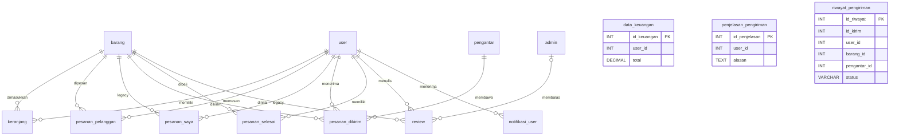

# Analisis dan Rekonstruksi Database Tekno-AER

## A. Ringkasan

- **Nama database:** `teknoaer`. Nama ini ditemukan langsung di [config/db.php](config/db.php) pada `$dbname`; bukan nama sementara.
- **Teknologi:** MySQL/MariaDB melalui MySQLi. Versi server tidak ditemukan.
- **Keluaran:** [tekno_aer_reconstruction.sql](tekno_aer_reconstruction.sql) berisi DDL untuk 14 tabel; [isi data teknoaer.sql](isi%20data%20teknoaer.sql) berisi skema yang sama beserta 15 produk contoh. Script belum dan tidak akan dijalankan dalam pekerjaan ini.
- **Batasan:** tidak ditemukan dump SQL, migration, dokumentasi skema, model/controller terpisah, API database, atau konfigurasi driver selain [config/db.php](config/db.php). Rancangan dibuat dari query, alur form, dan pemrosesan hasil yang tersedia. Kolom yang tidak ditulis/ditanyakan secara eksplisit, kunci teknis tambahan, panjang teks, serta beberapa tipe data adalah inferensi yang diberi tanda.
- **Keamanan:** file koneksi tidak diubah; password-nya tidak disalin ke dokumentasi. Tidak ada koneksi ke server, pembacaan/penulisan database, maupun eksekusi SQL.

## B. Inventaris sumber

Workspace telah dipastikan sebagai `C:\laragon\www\tekno-aer`. Inventaris rekursif menemukan **81 file**: **54 PHP**, file CSS/JavaScript, dan aset gambar. Semua file dan subfolder yang ada dapat diinventarisasi; tidak ada folder `vendor`, `node_modules`, cache, atau hasil build yang perlu dikecualikan. Folder yang diperiksa:

| Folder | Isi / relevansi |
|---|---|
| `config/` | Satu file koneksi database: `db.php`. |
| `public/` | Katalog, pencarian barang, detail/review, cart/checkout, registrasi/login user, pesanan dan notifikasi. |
| `public/user/` | Profil, riwayat pesanan, konfirmasi penerimaan, login/registrasi, review, dan notifikasi user. |
| `private/admin/` | Login/profil admin, katalog CRUD, pesanan, penugasan pengantar, review, dan laporan keuangan. |
| `private/pengantar/` | Login/profil pengantar, pesanan terkirim, penyelesaian/kegagalan antar, serta riwayat tugas. |
| `assets/`, `private/assets/` | CSS, JavaScript, gambar produk/logo, dan lokasi upload profil; bukan sumber skema SQL. |

Penelusuran pola query dan koneksi dilakukan terhadap seluruh file PHP. Seluruh 42 file PHP yang berisi query `SELECT`, `INSERT`, `UPDATE`, `DELETE`, introspeksi kolom, atau agregasi ditelusuri untuk nama tabel/kolom dan alur terkait; file relevan dibaca pada bagian akses data. JavaScript kustom juga diperiksa untuk request data; tidak ditemukan endpoint API terpisah yang mengakses DB. Library JavaScript/CSS pihak ketiga dan gambar tidak dianalisis baris demi baris karena bukan implementasi skema. Aset gambar bersifat biner sehingga tidak dibaca sebagai source text; nama/lokasinya hanya diinventarisasi. Tidak ada source PHP atau konfigurasi yang tidak dapat diakses.

| Sumber | Bukti / fungsi |
|---|---|
| [config/db.php](config/db.php#L2) | Host `localhost`; driver MySQLi; nama database `teknoaer` pada baris 5. Port tidak dinyatakan. Nilai password tidak dicantumkan di sini. |
| [public/index.php](public/index.php#L16) | Katalog/search barang dan introspeksi status notifikasi. |
| [public/beli.php](public/beli.php#L27) | Baca produk; tambah/ubah cart. |
| [public/checkout.php](public/checkout.php#L30) | Buat baris pesanan dan kosongkan cart. |
| [public/detail.php](public/detail.php#L15) | Barang, hak review, join user/admin, rating agregat. |
| [public/user/register.php](public/user/register.php#L30) dan [public/user/login.php](public/user/login.php#L21) | Akun user dan autentikasi. |
| [public/user/update_profil.php](public/user/update_profil.php#L35) | Profil, username/email, foto. |
| [public/user/pesanan.php](public/user/pesanan.php#L340) dan [public/user/detail_pesanan_saya.php](public/user/detail_pesanan_saya.php#L152) | Daftar dan detail pesanan/pengiriman/riwayat. |
| [public/user/notifikasi.php](public/user/notifikasi.php#L18) dan [public/user/detail_notifikasi.php](public/user/detail_notifikasi.php#L18) | Deteksi kolom ID/tanggal/status baca, baca dan hapus notifikasi. |
| [private/admin/barang_tambah.php](private/admin/barang_tambah.php#L71), [private/admin/barang_edit.php](private/admin/barang_edit.php#L42), [private/admin/barang_hapus.php](private/admin/barang_hapus.php#L23) | CRUD produk dan penghapusan data terkait. |
| [private/admin/pesanan_antar.php](private/admin/pesanan_antar.php#L25) dan [private/admin/pesanan_tidak_antar.php](private/admin/pesanan_tidak_antar.php#L21) | Penugasan antar dan alasan pesanan tidak dapat diantar. |
| [private/pengantar/antar_sukses.php](private/pengantar/antar_sukses.php#L23) dan [private/pengantar/antar_gagal.php](private/pengantar/antar_gagal.php#L30) | Transaksi penyelesaian/kegagalan, pencatatan riwayat, pengembalian pesanan, notifikasi. |
| [private/admin/data_keuangan.php](private/admin/data_keuangan.php#L30) | Laporan pendapatan dari riwayat pengiriman, bukan dari `data_keuangan`. |

Tidak ada file yang gagal dibaca atau subfolder proyek yang tidak terjangkau dalam inventaris ini.

## C. Daftar tabel

Nama tabel yang dibutuhkan oleh query aktif atau operasi yang tetap dieksekusi:

| Tabel | Fungsi |
|---|---|
| `user` | Akun pelanggan, profil, autentikasi. |
| `admin` | Akun/admin, profil dan balasan review. |
| `pengantar` | Akun dan profil pengantar. |
| `barang` | Katalog produk. |
| `keranjang` | Item belanja sementara per user. |
| `pesanan_pelanggan` | Antrean/pesanan per barang; `id_pesanan` dipakai sebagai ID grup transaksi. |
| `pesanan_saya` | Tabel legacy yang hanya dihapus oleh proses penugasan; tidak ditemukan pembacaan/penulisan aktif lain. |
| `pesanan_dikirim` | Baris tugas pengantaran aktif. `id_kirim` dipakai halaman user/pengantar. |
| `pesanan_selesai` | Catatan pembelian yang dipakai untuk pemeriksaan kelayakan review. |
| `review` | Rating/komentar user dan balasan admin. |
| `notifikasi_user` | Notifikasi user, tanda sudah dibaca dan waktu. |
| `data_keuangan` | Catatan yang ditulis saat user mengonfirmasi penerimaan; tidak dipakai laporan aktif. |
| `penjelasan_pengiriman` | Alasan admin saat pesanan dibatalkan/tidak dapat diteruskan ke pengantar. |
| `riwayat_pengiriman` | Riwayat sukses/gagal; dipakai riwayat user/pengantar dan laporan keuangan. |

## D. Rincian kolom

**Legenda bukti:** *Langsung* = nama/akses kolom tampak dalam query atau kode; *Inferensi* = tipe, panjang, nullability, default, atau key ditetapkan agar alur yang ditemukan dapat berfungsi. ID teknis yang tidak pernah disebut sebagai kolom aplikasi ditandai tersendiri. Batas panjang `VARCHAR`, pilihan `DECIMAL`, dan signedness merupakan rancangan, bukan metadata skema lama.

### `user`

| Nama Kolom | Tipe Data | Primary Key | Foreign Key | NULL | Default | Keterangan | Dasar/Bukti |
|---|---|---:|---|---|---|---|---|
| `user_id` | INT UNSIGNED AUTO_INCREMENT | Ya | — | Tidak | — | ID akun. | Langsung: login/register dan query user; tipe/key inferensi. |
| `nama_lengkap` | VARCHAR(255) | Tidak | — | Tidak | — | Nama profil. | Langsung: register/login/profil, mis. `register.php:55`. |
| `username` | VARCHAR(100) | Tidak | — | Tidak | — | Login; unik sesuai pemeriksaan duplikasi. | Langsung: `register.php:30`, `login.php:21`; UNIQUE inferensi. |
| `email` | VARCHAR(255) | Tidak | — | Tidak | — | Profil dan pemeriksaan duplikasi. | Langsung: `register.php:42`, `update_profil.php:99`; UNIQUE inferensi. |
| `password` | VARCHAR(255) | Tidak | — | Tidak | — | Login saat ini membandingkan teks biasa. | Langsung: `register.php:55`, `login.php:21`; panjang inferensi. |
| `foto_profil` | VARCHAR(255) | Tidak | — | Tidak | `'default.jpg'` | Nama/path relatif file, bukan blob. | Langsung: `update_profil.php:99`, header user; default inferensi. |

### `admin`

| Nama Kolom | Tipe Data | Primary Key | Foreign Key | NULL | Default | Keterangan | Dasar/Bukti |
|---|---|---:|---|---|---|---|---|
| `admin_id` | INT UNSIGNED AUTO_INCREMENT | Ya | — | Tidak | — | ID admin. | Langsung: login dan query profil. |
| `nama_lengkap` | VARCHAR(255) | Tidak | — | Tidak | — | Nama admin. | Langsung: login, profil, review. |
| `username` | VARCHAR(100) | Tidak | — | Tidak | — | Identitas login; unik dirancang. | Langsung: `private/admin/login.php:15`; UNIQUE inferensi. |
| `email` | VARCHAR(255) | Tidak | — | Tidak | — | Form/proses profil admin. | Langsung: `admin_edit_profil_process.php`; tipe/UNIQUE inferensi. |
| `password` | VARCHAR(255) | Tidak | — | Tidak | — | Login membandingkan teks; proses profil meng-hash password baru. | Langsung: login dan `admin_edit_profil_process.php`; kapasitas inferensi. |
| `role` | VARCHAR(50) | Tidak | — | Tidak | `'admin'` | Ditampilkan sebagai role; otorisasi memakai session `admin_id`. | Langsung: query review/dashboard; default inferensi. |
| `foto_profil` | VARCHAR(255) | Tidak | — | Ya | `NULL` | Nama file upload. | Langsung: form/proses profil. |

### `pengantar`

| Nama Kolom | Tipe Data | Primary Key | Foreign Key | NULL | Default | Keterangan | Dasar/Bukti |
|---|---|---:|---|---|---|---|---|
| `pengantar_id` | INT UNSIGNED AUTO_INCREMENT | Ya | — | Tidak | — | ID pengantar. | Langsung: login, assignment, profil. |
| `nama` | VARCHAR(255) | Tidak | — | Tidak | — | Nama yang ditampilkan. | Langsung: `login.php`, `dashboard.php`, `edit_profil.php`. |
| `username` | VARCHAR(100) | Tidak | — | Tidak | — | Login; unik dirancang. | Langsung: `private/pengantar/login.php:24`; UNIQUE inferensi. |
| `password` | VARCHAR(255) | Tidak | — | Tidak | — | Dibandingkan sebagai teks oleh login. | Langsung: `private/pengantar/login.php`; tipe inferensi. |
| `foto_profil` | VARCHAR(255) | Tidak | — | Ya | `NULL` | Nama file foto profil. | Langsung: query/update `edit_profil.php`. |

### `barang`

| Nama Kolom | Tipe Data | Primary Key | Foreign Key | NULL | Default | Keterangan | Dasar/Bukti |
|---|---|---:|---|---|---|---|---|
| `barang_id` | INT UNSIGNED AUTO_INCREMENT | Ya | — | Tidak | — | ID produk. | Langsung: query katalog dan CRUD. |
| `nama_barang` | VARCHAR(255) | Tidak | — | Tidak | — | Nama, pencarian, review, order. | Langsung: `barang_tambah.php:71`, `detail.php`. |
| `kategori` | VARCHAR(100) | Tidak | — | Tidak | — | Kategori dan filter dashboard. | Langsung: CRUD/dashboard admin. |
| `kondisi` | VARCHAR(100) | Tidak | — | Tidak | — | Kondisi yang diinput form. | Langsung: insert/update produk. |
| `keterangan` | TEXT | Tidak | — | Tidak | — | Deskripsi produk. | Langsung: insert/update produk. |
| `harga` | DECIMAL(14,2) UNSIGNED | Tidak | — | Tidak | `0.00` | Harga satuan; aplikasi mengirim nominal integer. | Langsung: katalog, cart, checkout; precision inferensi. |
| `gambar` | VARCHAR(255) | Tidak | — | Tidak | `''` | Nama file gambar upload. | Langsung: CRUD dan halaman barang. |

### `keranjang`

| Nama Kolom | Tipe Data | Primary Key | Foreign Key | NULL | Default | Keterangan | Dasar/Bukti |
|---|---|---:|---|---|---|---|---|
| `keranjang_id` | INT UNSIGNED AUTO_INCREMENT | Ya | — | Tidak | — | ID baris cart. | Langsung: update/delete cart. |
| `user_id` | INT UNSIGNED | Tidak | `user.user_id` | Tidak | — | Pemilik cart. | Langsung: operasi cart. |
| `barang_id` | INT UNSIGNED | Tidak | `barang.barang_id` | Tidak | — | Produk. | Langsung: operasi cart dan JOIN. |
| `nama_barang` | VARCHAR(255) | Tidak | — | Tidak | — | Snapshot saat masuk cart. | Langsung: `public/beli.php:70`. |
| `harga` | DECIMAL(14,2) UNSIGNED | Tidak | — | Tidak | `0.00` | Harga snapshot; checkout mengambil ulang harga katalog. | Langsung: `beli.php:70`, `beli_sekarang.php:51`. |
| `jumlah` | INT UNSIGNED | Tidak | — | Tidak | `1` | Kuantitas. | Langsung: cart/checkout. |
| `alamat` | VARCHAR(500) | Tidak | — | Tidak | `''` | Insert saat ini memang menyimpan string kosong. | Langsung: `beli.php:70`. |

### `pesanan_pelanggan`

| Nama Kolom | Tipe Data | Primary Key | Foreign Key | NULL | Default | Keterangan | Dasar/Bukti |
|---|---|---:|---|---|---|---|---|
| `id_pesanan` | INT UNSIGNED AUTO_INCREMENT | Ya* | — | Tidak | — | ID grup; beberapa baris dapat memiliki ID grup sama. Dibuat AUTO_INCREMENT agar insert kegagalan antar yang tidak menyertakan kolom ini tetap memperoleh ID. | Langsung: checkout, grouping; cara menampung grup dan insert yang menghilangkan ID adalah inferensi. |
| `user_id` | INT UNSIGNED | Ya* | `user.user_id` | Tidak | — | Pelanggan. | Langsung: checkout/list/detail. |
| `nama_pelanggan` | VARCHAR(255) | Tidak | — | Tidak | — | Snapshot nama. | Langsung: checkout dan penanganan gagal antar. |
| `barang_id` | INT UNSIGNED | Ya* | `barang.barang_id` | Tidak | — | Produk baris pesanan. | Langsung: checkout, JOIN, review eligibility. |
| `nama_barang` | VARCHAR(255) | Tidak | — | Tidak | — | Snapshot nama produk. | Langsung: checkout dan tampilan order. |
| `jumlah` | INT UNSIGNED | Tidak | — | Tidak | `1` | Kuantitas. | Langsung: checkout/list. |
| `harga` | DECIMAL(14,2) UNSIGNED | Tidak | — | Tidak | `0.00` | Harga satuan. | Langsung: checkout, agregasi `SUM(harga * jumlah)`. |
| `total` | DECIMAL(14,2) UNSIGNED | Tidak | — | Tidak | `0.00` | Total baris (`harga * jumlah`). | Langsung: checkout, assignment pengantar, laporan order. |
| `alamat_pengiriman` | TEXT | Tidak | — | Tidak | — | Alamat tujuan. | Langsung: checkout/pengiriman. |
| `alamat` | VARCHAR(500) | Tidak | — | Tidak | `''` | Kolom tambahan pada insert pengembalian gagal antar; tidak dipakai query baca. | Langsung: `antar_gagal.php` insert; fungsi inferensi. |
| `tanggal_pesanan` | DATETIME | Tidak | — | Tidak | `CURRENT_TIMESTAMP` | Waktu checkout/pengembalian. | Langsung: checkout memberi `NOW()`; default inferensi. |
| `harga_total` | DECIMAL(14,2) UNSIGNED | Tidak | — | Ya | `NULL` | Ditulis pada insert pengembalian gagal antar, bukan insert checkout biasa. | Langsung: `antar_gagal.php`; nullability inferensi. |

`*` Primary key komposit `(id_pesanan, user_id, barang_id)`: mempertahankan ID grup berulang sekaligus menolak duplikasi produk pada grup yang sama. Ini mengasumsikan satu baris per produk per grup; cart memang mencari/mengubah baris yang sudah ada, tetapi tidak memiliki constraint unik di kode lama.

### `pesanan_saya`

| Nama Kolom | Tipe Data | Primary Key | Foreign Key | NULL | Default | Keterangan | Dasar/Bukti |
|---|---|---:|---|---|---|---|---|
| `id_pesanan` | INT UNSIGNED | Ya* | — | Tidak | — | Hanya muncul pada kondisi DELETE legacy. | Langsung: `private/admin/pesanan_antar.php:78`. |
| `user_id` | INT UNSIGNED | Ya* | `user.user_id` | Tidak | — | Hanya dipakai pada kondisi DELETE. | Langsung: baris yang sama. |
| `barang_id` | INT UNSIGNED | Ya* | `barang.barang_id` | Tidak | — | Hanya disebut dalam daftar cleanup produk admin. | Langsung: `private/admin/barang_hapus.php:33`. |

`*` Primary key komposit. Tidak ditemukan query INSERT/SELECT ke tabel ini, sehingga skema selain tiga kolom yang dipakai delete tidak dapat dipastikan. Tabel tetap dibuat karena DELETE ke tabel itu merupakan operasi yang dijalankan aplikasi.

### `pesanan_dikirim`

| Nama Kolom | Tipe Data | Primary Key | Foreign Key | NULL | Default | Keterangan | Dasar/Bukti |
|---|---|---:|---|---|---|---|---|
| `id_kirim` | INT UNSIGNED AUTO_INCREMENT | Ya | — | Tidak | — | ID tugas/baris pengiriman, tidak disediakan oleh INSERT admin. | Langsung: `pesanan_antar.php:41`, query courier. |
| `id_pesanan` | INT UNSIGNED | Tidak | — | Tidak | — | ID grup asal. Tidak dibuat FK karena sumbernya dihapus setelah assignment. | Langsung: `pesanan_antar.php:41`. |
| `user_id` | INT UNSIGNED | Tidak | `user.user_id` | Tidak | — | Penerima. | Langsung: assignment, halaman user/courier. |
| `barang_id` | INT UNSIGNED | Tidak | `barang.barang_id` | Tidak | — | Produk. | Langsung: assignment/detail. |
| `nama_barang` | VARCHAR(255) | Tidak | — | Tidak | — | Snapshot produk. | Langsung: assignment/detail. |
| `jumlah` | INT UNSIGNED | Tidak | — | Tidak | `1` | Kuantitas. | Langsung: assignment/detail. |
| `harga` | DECIMAL(14,2) UNSIGNED | Tidak | — | Ya | `NULL` | Tidak diisi assignment admin; fallback courier membaca nilai opsional ini. | Langsung: `antar_sukses.php`, `antar_gagal.php`; nullability inferensi. |
| `harga_total` | DECIMAL(14,2) UNSIGNED | Tidak | — | Tidak | `0.00` | Nilai total yang diisi assignment. | Langsung: `pesanan_antar.php:41`. |
| `total` | DECIMAL(14,2) UNSIGNED | Tidak | — | Ya | `NULL` | Alias/fallback total yang dibaca courier, tetapi tidak diisi assignment. | Langsung: handler courier; nullable inferensi. |
| `alamat_pengiriman` | TEXT | Tidak | — | Tidak | — | Alamat penerima. | Langsung: assignment/detail. |
| `pengantar_id` | INT UNSIGNED | Tidak | `pengantar.pengantar_id` | Tidak | — | Pengantar yang ditugaskan. | Langsung: assignment dan filter courier. |
| `status` | VARCHAR(50) | Tidak | — | Tidak | `'dikirim'` | Status aktif; daftar courier memfilter nilai ini. | Langsung: `pesanan_antar.php:41`, `cek_pengiriman.php:32`. |
| `waktu` | DATETIME | Tidak | — | Tidak | `CURRENT_TIMESTAMP` | Waktu tugas dibuat. | Langsung: assignment memberi `NOW()`. |

### `pesanan_selesai`

| Nama Kolom | Tipe Data | Primary Key | Foreign Key | NULL | Default | Keterangan | Dasar/Bukti |
|---|---|---:|---|---|---|---|---|
| `id_selesai` | INT UNSIGNED AUTO_INCREMENT | Ya | — | Tidak | — | ID teknis; tidak digunakan langsung oleh aplikasi. | Inferensi; tabel diisi `konfirmasi.php:33`. |
| `user_id` | INT UNSIGNED | Tidak | `user.user_id` | Tidak | — | Pemilik transaksi. | Langsung: insert dan pemeriksaan eligibility review. |
| `barang_id` | INT UNSIGNED | Tidak | `barang.barang_id` | Tidak | — | Barang yang selesai. | Langsung: insert/review. |
| `nama_barang` | VARCHAR(255) | Tidak | — | Tidak | — | Snapshot nama. | Langsung: insert `konfirmasi.php:33`. |
| `jumlah` | INT UNSIGNED | Tidak | — | Tidak | `1` | Kuantitas. | Langsung: insert. |
| `harga_total` | DECIMAL(14,2) UNSIGNED | Tidak | — | Tidak | `0.00` | Total yang disimpan saat konfirmasi. | Langsung: insert. |

### `review`

| Nama Kolom | Tipe Data | Primary Key | Foreign Key | NULL | Default | Keterangan | Dasar/Bukti |
|---|---|---:|---|---|---|---|---|
| `id_review` | INT UNSIGNED AUTO_INCREMENT | Ya | — | Tidak | — | ID review. | Langsung: SELECT/UPDATE/DELETE review. |
| `user_id` | INT UNSIGNED | Tidak | `user.user_id` | Tidak | — | Penulis. | Langsung: insert/join. |
| `barang_id` | INT UNSIGNED | Tidak | `barang.barang_id` | Tidak | — | Produk. | Langsung: insert/join. |
| `rating` | TINYINT UNSIGNED | Tidak | — | Ya | `NULL` | Rating 1–5 pada form utama; endpoint legacy dapat menghilangkan kolom ini. | Langsung: insert `tambah_review_submit.php:42`, `public/tambah_review.php:19`, AVG. |
| `komentar` | TEXT | Tidak | — | Tidak | — | Isi review. | Langsung: insert/update review. |
| `tanggal` | DATETIME | Tidak | — | Tidak | `CURRENT_TIMESTAMP` | Urutan review; waktu default diperlukan karena insert tidak mengirim tanggal. | Langsung: review admin sort `tanggal`; default inferensi. |
| `balasan_admin` | TEXT | Tidak | — | Ya | `NULL` | Balasan admin. | Langsung: `private/admin/balas_review.php`. |
| `admin_id` | INT UNSIGNED | Tidak | `admin.admin_id` | Ya | `NULL` | Admin pembalas; nullable sebelum balasan. | Langsung: update/join review. |
| `waktu_balas` | DATETIME | Tidak | — | Ya | `NULL` | Waktu balasan, ditulis `NOW()`. | Langsung: `balas_review.php`. |

Unique `(user_id, barang_id)` mengikuti pengecekan review ganda pada detail produk. Endpoint legacy `public/tambah_review.php` tidak melakukan pengecekan tersebut; constraint ini dapat menolak duplikat yang dicoba melalui endpoint itu.

### `notifikasi_user`

| Nama Kolom | Tipe Data | Primary Key | Foreign Key | NULL | Default | Keterangan | Dasar/Bukti |
|---|---|---:|---|---|---|---|---|
| `id` | INT UNSIGNED AUTO_INCREMENT | Ya | — | Tidak | — | Nama dipilih dari alias ID pertama yang didukung deteksi kode. | Langsung pola deteksi `notifikasi.php:18`, `detail_notifikasi.php:18`; nama spesifik inferensi. |
| `user_id` | INT UNSIGNED | Tidak | `user.user_id` | Tidak | — | Pemilik. | Langsung: semua insert/select/delete notifikasi. |
| `pesan` | TEXT | Tidak | — | Tidak | — | Isi notifikasi. | Langsung: seluruh insert notifikasi. |
| `status_baca` | TINYINT(1) UNSIGNED | Tidak | — | Tidak | `0` | Memenuhi salah satu nama kolom status baca yang dideteksi aplikasi. | Langsung: `status_baca`/`is_read` detection; tipe/default inferensi. |
| `created_at` | TIMESTAMP | Tidak | — | Tidak | `CURRENT_TIMESTAMP` | Memenuhi nama tanggal yang dideteksi, mengurutkan terbaru. | Langsung: daftar alias `created_at`/lainnya dan sorting; default inferensi. |

Kode menerima beberapa nama ID/status/tanggal alternatif. Rancangan menetapkan pasangan yang didukung (`id`, `status_baca`, `created_at`) agar jalur baca/hapus dan hitung notifikasi menemukan kolomnya.

### `data_keuangan`

| Nama Kolom | Tipe Data | Primary Key | Foreign Key | NULL | Default | Keterangan | Dasar/Bukti |
|---|---|---:|---|---|---|---|---|
| `id_keuangan` | INT UNSIGNED AUTO_INCREMENT | Ya | — | Tidak | — | ID teknis inferensi. | Inferensi; tabel hanya ditulis oleh `konfirmasi.php:39`. |
| `user_id` | INT UNSIGNED | Tidak | — | Tidak | — | ID pelanggan yang dicatat. | Langsung: insert `konfirmasi.php:39`. |
| `nama_pelanggan` | VARCHAR(255) | Tidak | — | Tidak | — | Snapshot nama. | Langsung: insert. |
| `nama_barang` | VARCHAR(255) | Tidak | — | Tidak | — | Snapshot barang. | Langsung: insert. |
| `total` | DECIMAL(14,2) UNSIGNED | Tidak | — | Tidak | `0.00` | Total catatan keuangan. | Langsung: insert. |

Tidak dipasang FK pada data historis ini; kode laporan membaca agregat dari `riwayat_pengiriman`, bukan tabel ini.

### `penjelasan_pengiriman`

| Nama Kolom | Tipe Data | Primary Key | Foreign Key | NULL | Default | Keterangan | Dasar/Bukti |
|---|---|---:|---|---|---|---|---|
| `id_penjelasan` | INT UNSIGNED AUTO_INCREMENT | Ya | — | Tidak | — | ID teknis inferensi. | Inferensi; INSERT `pesanan_tidak_antar.php:42`. |
| `user_id` | INT UNSIGNED | Tidak | — | Tidak | — | ID penerima yang dicatat. | Langsung: INSERT. |
| `nama_pelanggan` | VARCHAR(255) | Tidak | — | Tidak | — | Snapshot nama penerima. | Langsung: INSERT. |
| `nama_barang` | VARCHAR(255) | Tidak | — | Tidak | — | Snapshot barang. | Langsung: INSERT. |
| `alasan` | TEXT | Tidak | — | Tidak | — | Alasan yang diinput admin. | Langsung: INSERT. |

### `riwayat_pengiriman`

| Nama Kolom | Tipe Data | Primary Key | Foreign Key | NULL | Default | Keterangan | Dasar/Bukti |
|---|---|---:|---|---|---|---|---|
| `id_riwayat` | INT UNSIGNED AUTO_INCREMENT | Ya | — | Tidak | — | ID baris historis; ditambahkan karena `id_kirim` dapat dipakai untuk beberapa item riwayat. | Inferensi; insert `antar_sukses.php:51`, `antar_gagal.php:89`. |
| `id_kirim` | INT UNSIGNED | Tidak | — | Tidak | — | ID shipment asal; dipakai grouping dan detail. Tidak FK karena baris aktif dihapus saat dipindah ke riwayat. | Langsung: history handlers/queries. |
| `user_id` | INT UNSIGNED | Tidak | — | Tidak | — | ID pelanggan pada snapshot riwayat. | Langsung: insert/join/laporan. |
| `barang_id` | INT UNSIGNED | Tidak | — | Tidak | — | ID barang; tetap disimpan bersama snapshot. | Langsung: insert/detail/list. |
| `nama_barang` | VARCHAR(255) | Tidak | — | Tidak | — | Nama snapshot. | Langsung: insert/agregasi. |
| `jumlah` | INT UNSIGNED | Tidak | — | Tidak | `1` | Kuantitas. | Langsung: insert/agregasi. |
| `harga` | DECIMAL(14,2) UNSIGNED | Tidak | — | Tidak | `0.00` | Harga satuan. | Langsung: insert/detail. |
| `total` | DECIMAL(14,2) UNSIGNED | Tidak | — | Tidak | `0.00` | Total item; dipakai laporan `SUM`. | Langsung: insert, `data_keuangan.php:32`. |
| `alamat_pengiriman` | TEXT | Tidak | — | Tidak | — | Alamat snapshot. | Langsung: insert/detail. |
| `pengantar_id` | INT UNSIGNED | Tidak | — | Tidak | — | ID pengantar pada riwayat. | Langsung: insert/detail. |
| `status` | VARCHAR(50) | Tidak | — | Tidak | — | Status `selesai` atau `gagal`. | Langsung: insert dan filter status. |
| `waktu_selesai` | DATETIME | Tidak | — | Tidak | `CURRENT_TIMESTAMP` | Waktu catatan dibuat; INSERT juga memberi `NOW()`. | Langsung: insert/laporan. |
| `catatan` | TEXT | Tidak | — | Ya | `NULL` | Keterangan sukses/gagal. | Langsung: insert history. |

Tidak ada FK dari tabel riwayat ke baris pesanan aktif, karena aplikasi memang menghapus sumbernya saat memindahkan data. Relasi akun/produk juga tidak dipaksakan pada tabel historis agar snapshot tidak kehilangan kegunaan jika entitas sumber kelak dihapus.

## E. Relasi dan integritas data



- FKs pada cart memakai `ON DELETE CASCADE`: item cart bersifat sementara dan tidak semestinya menghalangi penghapusan akun/produk. Notifikasi juga dibersihkan bersama user.
- Untuk pesanan/review aktif digunakan `RESTRICT` agar penghapusan user/produk tidak menghilangkan data transaksional diam-diam. Kode admin memang menghapus beberapa tabel terkait barang secara eksplisit sebelum penghapusan produk.
- Penghapusan admin yang menjadi penulis balasan memakai `SET NULL`; review tetap dipertahankan.
- `id_pesanan` bukan FK ke `pesanan_saya` atau `pesanan_dikirim`: tabel sumber pesanan dihapus setelah assignment, dan `id_pesanan` dapat mewakili banyak baris.
- Data keuangan, penjelasan, dan riwayat adalah catatan snapshot; tidak dipasang FK ke objek yang dapat berubah/dihapus. `riwayat_pengiriman.id_kirim` sengaja tidak menjadi FK karena ID itu berasal dari tabel aktif yang kemudian dihapus.
- Semua tabel menggunakan InnoDB dan `utf8mb4`. Tidak ada relasi melingkar.

## F. Pemetaan source code ke database

| Fitur / sumber | Operasi yang ditemukan | Tabel/kolom utama |
|---|---|---|
| Katalog, search, produk — `public/index.php`, `public/detail.php` | SELECT, LIKE, ORDER BY, AVG/COUNT, JOIN | `barang`; `user`; `admin`; `review`. |
| CRUD admin produk — `private/admin/barang_*.php`, `dashboard.php` | SELECT/INSERT/UPDATE/DELETE, filter kategori/nama | `barang`; `admin`; penghapusan terkait `review`, `pesanan_saya`, `pesanan_selesai`, `pesanan_dikirim`. |
| Cart — `public/beli.php`, `keranjang.php`, `update_keranjang.php`, `hapus_keranjang.php` | SELECT/JOIN, INSERT, UPDATE jumlah, DELETE | `keranjang`, `barang`, `user`, `notifikasi_user`. |
| Checkout — `public/checkout.php` | Nama user/produk, `MAX(id_pesanan)`, INSERT item, DELETE cart | `user`, `barang`, `keranjang`, `pesanan_pelanggan`. |
| Daftar/detail pesanan — `public/user/pesanan.php`, `detail_pesanan_saya.php` | GROUP_CONCAT/SUM/GROUP BY/ORDER BY, JOIN data barang, pencarian sumber sesuai jenis/status | `pesanan_pelanggan`, `pesanan_dikirim`, `riwayat_pengiriman`, `barang`, `user`. |
| Assignment pengantar — `private/admin/pilih_pengantar.php`, `pesanan_antar.php` | SELECT grouped order, INSERT shipment, DELETE antrean, INSERT notif | `pesanan_pelanggan`, `pengantar`, `pesanan_dikirim`, `pesanan_saya`, `notifikasi_user`. |
| Proses antar — `private/pengantar/antar_sukses.php`, `antar_gagal.php` | transaksi DB, SELECT, INSERT history/requeue/notif, DELETE shipment | `pesanan_dikirim`, `riwayat_pengiriman`, `pesanan_pelanggan`, `user`, `notifikasi_user`. |
| Pembatalan admin — `private/admin/pesanan_tidak_antar.php` | SELECT pesanan, INSERT alasan/notif, DELETE antrean | `pesanan_pelanggan`, `penjelasan_pengiriman`, `notifikasi_user`. |
| Konfirmasi user — `public/user/konfirmasi.php` | SELECT shipment, INSERT selesai/keuangan/notif, DELETE shipment | `pesanan_dikirim`, `pesanan_selesai`, `data_keuangan`, `notifikasi_user`. |
| Review — `public/user/tambah_review*.php`, `edit_review.php`, `hapus_review.php`, `private/admin/review_barang.php`, `balas_review.php` | INSERT/UPDATE/DELETE, COUNT/AVG, JOIN, sort | `review`, `pesanan_pelanggan`, `pesanan_selesai`, `barang`, `user`, `admin`. |
| Login/profil — `public/user/*`, `private/admin/*`, `private/pengantar/*` | SELECT akun, INSERT user, UPDATE profil | `user`, `admin`, `pengantar`. Session PHP tidak memakai tabel session. |
| Notifikasi — `public/index.php`, `keranjang.php`, `public/user/notifikasi.php`, `detail_notifikasi.php` | SHOW COLUMNS, COUNT, SELECT/ORDER, UPDATE read, DELETE | `notifikasi_user`, `user`. |
| Laporan keuangan — `private/admin/data_keuangan.php` | JOIN, GROUP_CONCAT, SUM, MAX, GROUP BY, ORDER BY | `riwayat_pengiriman`, `user`, `pesanan_pelanggan` untuk hitungan sidebar. |

Upload menyimpan file pada folder aset dan nama file pada kolom `gambar`/`foto_profil`; konten file tidak disimpan di database. Untuk akun, aplikasi memakai tabel terpisah `admin`, `pengantar`, dan `user`; tidak ada tabel registry role bersama, dan menambahkannya tidak akan mengaktifkannya di aplikasi. Tidak ditemukan kebutuhan database untuk trigger, view, stored procedure, atau tabel session.

## G. Data awal

File dasar [tekno_aer_reconstruction.sql](tekno_aer_reconstruction.sql) tidak membuat data awal. File tambahan [isi data teknoaer.sql](isi%20data%20teknoaer.sql) menyertakan 15 produk teknologi contoh beserta harga/kondisi/deskripsi ilustratif dan foto produk lokal di `private/assets/uploads/produk-*`. Foto bukan gambar kartun yang dibuat untuk seed sebelumnya; semua 15 gambar lama diganti dengan foto Wikimedia Commons berlisensi terbuka. Kredit dan lisensi tiap foto tercantum di bawah. Produk/harga bukan inventaris terverifikasi, dan foto hanya representatif—model/keadaan foto tidak selalu identik dengan produk contoh.

Tiga jenis akun aplikasi tetap memakai tabel terpisah: `admin`, `pengantar`, dan `user`. Tidak ada akun login yang disisipkan. Source tidak menyediakan akun awal atau kredensial yang aman; role tidak dibuat sebagai baris pada tabel baru karena aplikasi tidak membaca registry role.

**Catatan akun:** jangan menambahkan password teks biasa sebagai seed. User dan pengantar saat ini membandingkan password teks biasa. Admin juga membandingkan password teks biasa saat login, sedangkan form ubah password admin menyimpan hasil `password_hash()`. Akibatnya password admin yang diubah melalui form tersebut tidak akan cocok dengan login saat ini. Sebelum membuat akun secara manual, tentukan prosedur aman dan selaraskan mekanisme autentikasi; rekonstruksi skema ini tidak memperbaiki source code.

## H. Asumsi dan ketidakpastian

### Temuan langsung

- Database `teknoaer`, MySQLi, dan host `localhost` tertulis pada `config/db.php`; port tidak ditentukan.
- Tabel serta kolom aplikasi yang digunakan dirangkum pada bagian C–F.
- `status_baca`/`is_read`, nama ID, dan nama tanggal notifikasi dideteksi dinamis.
- Foto dan gambar adalah nama/path file, sementara operasi transaksi kurir menggunakan transaksi InnoDB.

### Kesimpulan

- Kolom kunci bernama `*_id` yang dipakai sebagai identitas dipetakan ke integer unsigned; nilai dibind sebagai integer pada kode.
- Nominal berupa `DECIMAL(14,2)`, sebab aplikasi memproses uang dan total; form saat ini umumnya mengubah harga ke integer sehingga pecahan bukan kebutuhan terverifikasi.
- Panjang teks, primary key teknis untuk tabel tanpa ID eksplisit, dan indeks didesain agar query yang ditemukan dapat berjalan.
- Nama kolom notifikasi `id`, `status_baca`, dan `created_at` dipilih dari alternatif yang secara eksplisit dikenali kode.
- File `isi data teknoaer.sql` menyisipkan tepat 15 produk contoh dan menunjuk pada foto lokal berlisensi terbuka di `private/assets/uploads/`.

### Kredit foto produk

Foto diunduh dari Wikimedia Commons dalam ukuran thumbnail; lisensi sumber tetap berlaku. Kredit dicantumkan di sini agar informasi atribusi ikut tersimpan bersama project. Beberapa gambar adalah foto perangkat/model tertentu yang hanya mewakili kategori, bukan klaim bahwa model itu tersedia untuk dijual.

| File lokal | Sumber / pencipta | Lisensi |
|---|---|---|
| `produk-laptop.webp` | [System76 product darp8](https://commons.wikimedia.org/wiki/File:System76_product_darp8.webp) — System76 | [GPLv3](https://www.gnu.org/licenses/gpl-3.0.html) |
| `produk-smartphone.jpg` | [Nokia Lumia 620](https://commons.wikimedia.org/wiki/File:Nokia_Lumia_620.JPG) — shubs | [CC BY-SA 3.0](https://creativecommons.org/licenses/by-sa/3.0/) |
| `produk-tablet.jpg` | [Tablet on a newspaper (Unsplash)](https://commons.wikimedia.org/wiki/File:Tablet_on_a_newspaper_(Unsplash).jpg) — Matthew Guay | [CC0](https://creativecommons.org/publicdomain/zero/1.0/) |
| `produk-headphone-wireless.jpg` | [Afterglow AGU.1 Wireless Headphones](https://commons.wikimedia.org/wiki/File:Afterglow_AGU.1_Wireless_Headphones.jpg) — Seqqis | [CC BY-SA 3.0](https://creativecommons.org/licenses/by-sa/3.0/) |
| `produk-keyboard.jpg` | [Re-Zero white computer keyboard](https://commons.wikimedia.org/wiki/File:Re-Zero_white_computer_keyboard_20180101.jpg) — Solomon203 | [CC BY-SA 4.0](https://creativecommons.org/licenses/by-sa/4.0/) |
| `produk-mouse.jpg` | [Amazon Basics Wireless Computer Mouse](https://commons.wikimedia.org/wiki/File:Amazon_Basics_Wireless_Computer_Mouse.jpg) — TaurusEmerald | [CC BY-SA 4.0](https://creativecommons.org/licenses/by-sa/4.0/) |
| `produk-monitor.png` | [Hyundai PC Monitor](https://commons.wikimedia.org/wiki/File:Hyundai-PC-Monitor_20241207_HOF8559-HDR_RAW-Export.png) — PantheraLeo1359531 | [CC BY 4.0](https://creativecommons.org/licenses/by/4.0/) |
| `produk-webcam.jpg` | [HP web camera closeup](https://commons.wikimedia.org/wiki/File:Hp_web_camera_closeup.jpg) — Nenad Stojkovic | [CC BY 2.0](https://creativecommons.org/licenses/by/2.0/) |
| `produk-router-wifi.jpg` | [Huawei HG520V Home Gateway](https://commons.wikimedia.org/wiki/File:Huawei_HG520V_Home_Gateway.jpg) — Mk2010 | [CC BY-SA 3.0](https://creativecommons.org/licenses/by-sa/3.0/) |
| `produk-printer.jpg` | [Canon S520 ink jet printer](https://commons.wikimedia.org/wiki/File:Canon_S520_ink_jet_printer.jpg) — André Karwath aka Aka | [CC BY-SA 2.5](https://creativecommons.org/licenses/by-sa/2.5/) |
| `produk-ssd.jpg` | [Samsung 960 PRO SSD](https://commons.wikimedia.org/wiki/File:SSD_Samsung_960_PRO_512GB_-_front_and_back_-_2018-05-27.jpg) — Bretwa | [CC BY-SA 4.0](https://creativecommons.org/licenses/by-sa/4.0/) |
| `produk-flashdisk.jpg` | [Swissbit Industrial USB Flash Drive](https://commons.wikimedia.org/wiki/File:16876_-_Swissbit_Industrial_USB_Flash_Drive_-_16GB_(cropped).jpg) — SparkFun Electronics | [CC BY 2.0](https://creativecommons.org/licenses/by/2.0/) |
| `produk-powerbank.jpg` | [SONY CP-VC10 POWER BANK](https://commons.wikimedia.org/wiki/File:SONY_CP-VC10_POWER_BANK.jpg) — Dinkun Chen | [CC BY-SA 4.0](https://creativecommons.org/licenses/by-sa/4.0/) |
| `produk-speaker-bluetooth.jpg` | [Beats Pill Portable Bluetooth Speaker](https://commons.wikimedia.org/wiki/File:Beats_By_Dr._Dre_Pill_Portable_Bluetooth_Speaker_Black_N2.jpg) — Beats | [CC0](https://creativecommons.org/publicdomain/zero/1.0/) |
| `produk-smartwatch.jpg` | [Garmin Forerunner 55](https://commons.wikimedia.org/wiki/File:Garmin_Forerunner_55.jpg) — Melyanac | [CC0](https://creativecommons.org/publicdomain/zero/1.0/) |

### Asumsi / dampak

- Struktur lama tidak diketahui; khususnya `pesanan_saya` hanya terdeteksi pada DELETE. Definisi minimum tiga kolom tidak membuktikan bentuk lengkap tabel lama.
- Primary key komposit `pesanan_pelanggan(id_pesanan,user_id,barang_id)` menganggap satu produk hanya satu baris pada sebuah order. Jika aplikasi perlu mencatat baris produk identik lebih dari sekali dalam satu grup, skema harus ditinjau.
- `pesanan_pelanggan.id_pesanan` dibuat AUTO_INCREMENT non-unik dalam kunci komposit: checkout tetap dapat menetapkan ID grup yang sama pada beberapa item, sementara insert gagal antar yang tidak mengirim `id_pesanan` tidak langsung gagal. ID yang dibuat otomatis untuk item-item pengembalian dapat menjadi grup terpisah.
- `foto_profil` user default `default.jpg`, `role` admin default `admin`, `jumlah` default `1`, status kirim default `dikirim`, dan nilai default timestamp adalah pilihan rancangan, bukan hasil dump.
- Tidak ada constraint CHECK untuk batas rating 1–5 atau kuantitas positif agar kompatibilitas lintas versi tetap luas; validasi aplikasi tetap harus dilakukan.
- Versi MySQL/MariaDB aktual tidak dapat diketahui dari source. DDL memakai sintaks umum MySQL/MariaDB modern (InnoDB, `utf8mb4`, `DECIMAL`, FK, `CURRENT_TIMESTAMP`).

## I. Potensi masalah yang ditemukan

1. **Autentikasi tidak konsisten.** Registrasi user menyimpan password biasa; login user/admin/pengantar membandingkan teks biasa. Proses edit profil admin menyimpan `password_hash()`, tetapi login admin tidak memakai `password_verify()`. Jangan membuat akun berpassword sampai mekanisme ini diselaraskan.
2. **ID pada konfirmasi berbeda.** `pesanan.php` mengirim `id_kirim` ke `konfirmasi.php`, tetapi query konfirmasi mencari shipment berdasarkan `id_pesanan`. `id_kirim` dan `id_pesanan` adalah kolom berbeda dalam skema ini; fitur konfirmasi dapat gagal atau mengambil baris yang salah.
3. **Assignment hanya mengambil satu baris.** `pilih_pengantar.php` dapat menampilkan beberapa item satu order, tetapi `pesanan_antar.php` hanya mengambil `fetch_assoc()` pertama lalu menghapus semua baris dengan `id_pesanan` itu. Item lain tidak ikut dipindahkan.
4. **Pengembalian pesanan gagal tidak mengirim `id_pesanan`.** Insert ke `pesanan_pelanggan` menghilangkan kolom tersebut. AUTO_INCREMENT pada skema ini membuat insert diterima, tetapi tiap baris yang dikembalikan dapat menjadi grup baru dan bukan identitas order asal.
5. **Konfirmasi tidak transaksional.** `konfirmasi.php` menjalankan beberapa INSERT dan DELETE tanpa transaksi; kegagalan di tengah dapat meninggalkan data parsial.
6. **Kolom harga shipment tidak seragam.** Assignment hanya mengisi `harga_total`; handler courier juga membaca `harga`/`total`. Kedua kolom ini dibuat nullable agar fallback `harga_total` yang terlihat dalam kode tetap bekerja. Perhitungan data nyata perlu diuji manual.
7. **Data keuangan ganda/beda sumber.** Konfirmasi menulis ke `data_keuangan`, tetapi report aktual menghitung dari `riwayat_pengiriman`; kedua tabel dapat tidak sejalan.
8. **Endpoint review legacy.** `public/tambah_review.php` tidak menulis rating dan tidak mengecek kepemilikan pembelian/duplikasi. `rating` dibuat nullable agar INSERT ini tidak gagal, dan UNIQUE user/produk menjaga satu review per pasangan.
9. **Alamat bawaan hanya komentar.** Pembacaan `user.alamat_default` pada `beli_sekarang.php` dikomentari; checkout mewajibkan alamat dari form. Karena itu kolom `alamat_default` tidak ditambahkan.
10. **Review user disaring dari pesanan aktif.** Detail produk mengecek `pesanan_pelanggan`, sedangkan endpoint submit baru mengecek `pesanan_selesai`. Kapan review diizinkan bergantung pada state pesanan dan dapat tidak konsisten.
11. **Tabel legacy `pesanan_saya` tidak mempunyai sumber data aktif yang ditemukan.** Operasi DELETE saja tersedia, sehingga isi/kegunaan masa lalunya belum dapat dipastikan.
12. **Constraint dan nilai data nyata belum dapat diuji.** Tidak ada DB/dump yang boleh diakses. Foreign key dapat mengungkap orphan IDs pada data setelah import; skema baru dimulai kosong.

## J. Konfigurasi Laragon

`config/db.php` memakai MySQLi, host literal `localhost`, username yang ditentukan di file, dan nama database `teknoaer`; port tidak diberikan dan port aktual tidak dapat dipastikan dari source. Nilai password tidak diulang di sini. Jangan anggap host/port/user/password tersebut cocok dengan instalasi Laragon Anda.

Tidak ada perubahan pada file koneksi. Setelah meninjau SQL, sesuaikan secara manual dengan koneksi lokal Anda sendiri, misalnya:

```php
$servername = '<HOST_MYSQL_LARAGON>';
$username = '<USERNAME_MYSQL_LARAGON>';
$password = '<PASSWORD_MYSQL_LARAGON>';
$dbname = 'teknoaer';
```

Isi port hanya jika konfigurasi lokal memerlukan port non-default dan sesuaikan argumen `new mysqli(...)` secara manual. Pastikan virtual host/project mengarah ke folder `public/` sesuai struktur aplikasi. Contoh di atas placeholder, bukan kredensial yang diverifikasi.

## K. Cara memeriksa dan menjalankan secara manual

1. Buka client database yang Anda pilih dari instalasi Laragon dan verifikasi koneksi lokal secara manual.
2. Buka [isi data teknoaer.sql](isi%20data%20teknoaer.sql) sebagai file teks terlebih dahulu jika ingin membuat skema sekaligus menyisipkan 15 produk contoh. [tekno_aer_reconstruction.sql](tekno_aer_reconstruction.sql) tetap tersedia sebagai file skema tanpa produk seed.
3. Pastikan targetnya tepat `teknoaer` dan nama itu **belum digunakan**. Karena script menggunakan `CREATE DATABASE` tanpa `IF NOT EXISTS`, hentikan jika database bernama sama telah ada; jangan ganti dengan database lain.
4. Tinjau seluruh DDL/constraint dan pastikan koneksi client mengarah ke server Laragon yang memang Anda maksud.
5. Jalankan manual hanya setelah Anda menyetujui target dan isi script. Tidak ada langkah ini yang dijalankan oleh analisis ini.

## L. Validasi statis dan checklist setelah import

### Validasi yang dilakukan tanpa server

- Menelusuri query PHP `SELECT`, `INSERT`, `UPDATE`, `DELETE`, `JOIN`, `GROUP BY`, `ORDER BY`, agregasi, serta `SHOW COLUMNS`; mencocokkan tabel/kolom ke DDL.
- Mencocokkan kolom INSERT yang ditemukan: user, barang, cart, pesanan, shipment, riwayat, review, notifikasi, data keuangan, dan alasan pengiriman; serta memeriksa seed 15 produk pada file tambahan.
- Memastikan kolom dinamis notifikasi yang dipilih sesuai daftar alias pada aplikasi.
- Memastikan urutan CREATE TABLE memenuhi semua FK; relasi melingkar tidak ada.
- Memastikan transaksi pengantaran memakai InnoDB.
- Memeriksa script secara statis: satu `CREATE DATABASE teknoaer`, satu `USE teknoaer`, dan definisi `CREATE TABLE` beserta indeks/constraint; tidak ada `DROP`, `TRUNCATE`, statement `DELETE`/`UPDATE`/`ALTER`, `CREATE USER`, atau `GRANT`.

**Tidak** ada SQL yang dieksekusi, koneksi database, import, atau klaim bahwa pembuatan database berhasil. Validasi syntax final terhadap versi server dan hasil query hanya mungkin sesudah pemilik memeriksa dan menjalankan sendiri.

### Belum dapat divalidasi tanpa data/server

- SQL parse/DDL pada versi MySQL/MariaDB dan konfigurasi Laragon yang sebenarnya.
- Kondisi orphan/duplikasi pada data lama (database lama dinyatakan hilang; tidak ada dump).
- Apakah `pesanan_saya` pernah memiliki kolom lain.
- Perilaku kueri dan batas panjang untuk nilai nyata, urutan transaksi, autentikasi, serta hasil CRUD.
- Konsistensi order multi-item saat assignment/pengembalian/konfirmasi akibat ketidaksesuaian alur yang dijelaskan pada bagian I.

### Checklist manual setelah Anda menjalankan SQL

- [ ] Verifikasi nama database dan seluruh 14 tabel; jangan jalankan ulang jika database target sudah ada.
- [ ] Jika memakai file SQL dengan seed, verifikasi 15 produk tampil dan tiap nama file gambarnya ada di `private/assets/uploads/`.
- [ ] Sesuaikan koneksi `config/db.php` dengan host/port/akun lokal tanpa memakai kredensial yang belum diverifikasi.
- [ ] Buat akun awal secara aman setelah menyelaraskan hashing password di registrasi/login/admin/pengantar.
- [ ] Uji login/registrasi user, login admin, dan login pengantar dengan akun yang telah dibuat manual.
- [ ] Uji katalog, pencarian, detail produk, upload gambar, tambah/edit/hapus produk.
- [ ] Uji cart: tambah item, kuantitas, hapus item, cart kosong, dan checkout satu/lebih produk.
- [ ] Uji daftar/detail pesanan, assignment pengantar, pengantaran berhasil, gagal antar, serta riwayat.
- [ ] Uji konfirmasi penerimaan; periksa perbedaan `id_kirim` dan `id_pesanan` sebelum mengandalkan fitur.
- [ ] Uji review create/edit/delete, review tanpa rating dari endpoint lama, dan balasan admin.
- [ ] Uji notifikasi: daftar, tanda dibaca, hitung belum dibaca, hapus satu, dan hapus semua.
- [ ] Uji alasan pembatalan dan laporan keuangan; bandingkan `data_keuangan` dengan `riwayat_pengiriman`.
- [ ] Uji FK ketika menghapus produk yang masih ada di cart/order/review agar perilaku RESTRICT/CASCADE dipahami.
